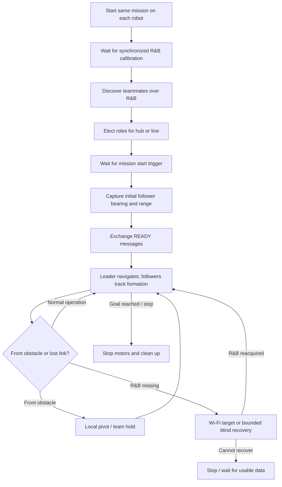

<div align="center">

# 🤖 PiPuck — Cooperative Robot Team Mission

### Multi-robot navigation with Range & Bearing, Wi-Fi coordination, obstacle avoidance, and recovery

**2–3 PiPuck robots · Hub & line formations · One-command mission launcher · Distributed leader election · Onboard camera recording**

*One robot navigates to a goal. The others follow, coordinate their movements, react to obstacles, and attempt to recover when contact is lost.*

</div>

---


### Explore this README

[Overview](#-overview) · [Formations](#formations) · [How it works](#how-the-mission-works) · [Architecture](#6-communication-architecture) · [Run the mission](#running-the-mission) · [Record video](#-recording-the-robots-point-of-view) · [Troubleshooting](#troubleshooting) 

## 📖 Overview

This project implements a **cooperative, distributed navigation mission** for a small team of GCtronic PiPuck/e-puck2 robots. Each robot runs the **same mission program**, identifies itself from its hostname (`pipuck0`, `pipuck1`, etc.), and independently determines its role.

The team uses **Range & Bearing (R&B)** for relative direction/distance measurements and short control messages, **Wi-Fi** for sharing odometry and obstacle status, **wheel encoders** for local movement estimates, and **infrared proximity sensors** for obstacle detection.

The implementation supports:

- **Follower - Leader formation:** a leader travels toward a goal while a follower follows that leader.
- **Hub formation:** triangle-like formation: one leader travels toward a goal while the other robots (2 robots) follow that leader.
- **Line formation:** a front leader, an optional middle *local leader*, and a tail follower form a chain.
- **Two election modes:** simple minimum-ID selection or bearing-based, position-aware role selection.
- **Cooperative obstacle handling:** robots communicate movement, slowdown, and hold status.
- **Loss-of-contact recovery:** fresh R&B takes priority; Wi-Fi displacement and time-limited blind movement provide fallbacks.
- **Independent POV recording:** an optional OpenCV recorder saves camera footage without controlling the robot.

> [!IMPORTANT]
> This is a **research/educational robotics implementation**, not a guaranteed collision-free navigation system. Proximity sensing, local odometry, radio reception, and recovery can fail. Test at low speeds in a controlled area, keep an operator nearby, and make sure you can stop all robots.

## Formations

### Leader - Follower 

```text
                   Goal
                    ▲
                    │
                🔴 Leader
                    ▲
                    │  
               🔵 Follower
```
The **leader** navigates toward the target waypoint. The followers track the leader's filtered R&B bearing and range, using the initially captured formation geometry as his desired relative position. If a teammate is avoiding an obstacle, the mission can slow or hold the rest of the team.

### Hub — one leader, multiple followers

```text
                   Goal
                    ▲
                    │
                🔴 Leader
                 ↗     ↖
          🔵 Follower  🔵 Follower
```

The **leader** navigates toward the target waypoint. Both followers track the leader's filtered R&B bearing and range, using the initially captured formation geometry as their desired relative position. If a teammate is avoiding an obstacle, the mission can slow or hold the rest of the team.

### Line — leader, local leader, follower

```text
                   Goal
                    ▲
                    │
                🔴 Leader
                    ▲
                    │  follows front robot
               🟣 Local leader
                    ▲
                    │  follows middle robot
               🔵 Follower
```

The **middle robot** follows the front leader while also coordinating with the tail robot. This matters because, in a long line, the front and rear robots may not reliably receive one another's R&B transmissions. With three robots, the line roles are **leader (red), local leader (purple), follower (blue)**.

**Before starting:** physically place the robots in the intended formation and give them approximately aligned initial headings. The system captures relative positions; it does not automatically assemble a scattered team into a formation.

## How the mission works



### 1. Startup, discovery, and election

The root-level `start_team_rab.sh` launcher starts `team_mission_rab.py` on each enabled robot with the same team size, formation mode, and target. Startup uses **marker files**, coordinated by the launcher, to keep the robots synchronized before they move:

1. Each robot first signals `RAB_CALIBRATION_READY`; once all active robots are ready, the launcher creates `RAB_CALIBRATE` to trigger ambient calibration.
2. Robots discover teammates by exchanging R&B messages.
3. The **default election** chooses the robot with the smallest discovered ID. With `--smart-election`, the mission instead uses relative R&B bearings and position information. In hub mode, the intended leader is the physically frontmost robot; in line mode, each robot infers its position from its directly observed neighbors.
4. Each robot creates `RAB_ELECTION_READY` after it has selected its role. The mission waits for `RAB_TEAM_START` before beginning movement.
5. Followers capture stable initial relative bearing/range measurements and exchange **READY** messages before coordinated motion begins.

> **Smart election is geometry-dependent.** Robots should start stationary, in an appropriate arrangement, with compatible headings and usable R&B measurements. No election method can overcome completely missing or contradictory sensor observations.

### 2. Leader navigation

`ReachGoalController` in `reach_goal_rab.py` estimates the leader's position from wheel encoders, then steers toward the configured `(x, y)` waypoint. Coordinates are **millimeters relative to the leader's starting frame**: `+x` is right and `+y` is forward.

A front proximity detection causes a **left pivot in place**. The leader waits for several clear sensor frames, turns an additional angle for clearance, and then resumes seeking the target. This is **not** a full wall-following or path-planning algorithm.

### 3. Follower tracking

`RangeBearingFollower` in `follow_rob.py` first captures the desired formation offset. During normal following it:

- Filters the measured **bearing** and adjusts differential wheel speeds to steer toward the desired relative direction.
- Compares the latest **raw R&B range estimate** with the captured target range, slowing down when too close and speeding up when farther away.
- Applies speed limits and per-step wheel-command smoothing.
- Uses dedicated side proximity sensors for gentle steering away from nearby objects, while giving front-obstacle handling priority.

> R&B `range_raw` is a board-provided measurement, **not automatically a calibrated distance in millimeters**. The normal follower controller tracks relative values rather than assuming an exact physical distance.

### 4. Cooperative obstacle avoidance

The robots share motion and follower-status information via R&B messages, supplemented by Wi-Fi obstacle status. Depending on the situation, the team can **slow down or hold position** while a robot handles its local obstruction.

The follower's front-obstacle controller uses a **fixed left pivot**, waits for consecutive clear readings, and then returns to normal R&B tracking. The leader also pivots left but adds a further clearance turn. These are intentionally simple, local reactive behaviors: they do **not** guarantee a collision-free path around arbitrary obstacles.

### 5. R&B loss and recovery

R&B is the **primary** source of formation tracking. After a prolonged gap in usable R&B communication (the current mission uses approximately **2 seconds** as its loss threshold), a follower attempts to recover:

1. **Fresh Wi-Fi position report:** use the front robot's local odometry displacement as a waypoint.
2. **No fresh Wi-Fi report:** attempt a bounded, obstacle-checked forward recovery (initial blind limit **10 seconds**).
3. **Recovery limit or unsafe conditions:** stop and enter a waiting state until usable information returns; Wi-Fi recovery also has a bounded overall window.
4. **R&B reacquired:** return to the normal R&B follower controller.

**Important coordinate assumption:** each robot initializes its odometry independently. Interpreting the front robot's Wi-Fi `(x, y)` as the follower's displacement target is only meaningful when the robots start with **aligned physical coordinate axes**. Wi-Fi data is not a globally synchronized localization system, and recovery is best-effort.

### 6. Communication architecture

| Channel | Purpose | Relevant files |
|---|---|---|
| **R&B infrared** | Discovery, election, relative bearings/ranges, READY, heartbeats, movement/hold flags | `range_and_bearing.py`, `range_and_bearing_protocol.py`, `range_and_bearing_filter.py` |
| **Wi-Fi / UDP broadcast** | Exchange robot-local odometry and obstacle status; support recovery | `wifi_state.py` |
| **Wheel encoders** | Estimate local pose and heading | `odometry.py` |
| **IR proximity** | Detect nearby obstacles and guide local avoidance | `follow_rob.py`, `reach_goal_rab.py`, `safe_recovery.py` |

R&B payloads use a **16-bit format** with a 3-bit message type, 2-bit sender ID, 7-bit sequence/status field, and 4-bit CRC. The mission schedules transmissions in **four 120 ms slots** (480 ms per cycle), with a **10 ms guard interval on each side** of a slot. The robots' clocks therefore need to be sufficiently synchronized.

Wi-Fi status is broadcast as UDP JSON on **port 5005**, approximately every **200 ms**; received teammate data is checked for freshness. This is a lightweight coordination channel, not a reliable or authenticated messaging service.

## Project structure

The launcher is located **at the root of the project, outside the individual robot folders**. Its directory layout is:

```text
proj-rob/
├── README.md
├── start_team_rab.sh           # Run the complete mission from your Mac
├── rob0/                       # Source files for pipuck0
├── rob1/                       # Source files for pipuck1
├── rob2/                       # Source files for pipuck2
├── experiments/                # Optional previous experiments (if present)
└── tools/                      # Optional utilities (if present)
```

Run the launcher **from this project root**: it looks for source files in `rob0/`, `rob1/`, and `rob2/` relative to the current directory (and falls back to a file in the current directory if that robot's copy is absent).

### Core mission files

| File | Responsibility |
|---|---|
| `start_team_rab.sh` | Mac-side team launcher: select robots, configure formation/goal, upload code, coordinate calibration/election/start, show live status, and stop robots |
| `team_mission_rab.py` | Main robot program: discovery, election, team coordination, role loops |
| `follow_rob.py` | R&B follower tracking and local obstacle behavior |
| `reach_goal_rab.py` | Leader goal-seeking controller |
| `safe_recovery.py` | Wi-Fi displacement and time-limited blind recovery |
| `wifi_state.py` | Wi-Fi broadcaster, receiver, and freshness cache |
| `odometry.py` | Encoder-based position/heading tracking |
| `range_and_bearing.py` | Low-level I2C R&B board driver |
| `range_and_bearing_filter.py` | Robust bearing/range signal filtering |
| `range_and_bearing_protocol.py` | 16-bit mission message codec |
| `record_pov.py` *(optional)* | Independent camera recorder |

**Deployment detail:** the current `start_team_rab.sh` explicitly uploads these seven files for each enabled robot: `team_mission_rab.py`, `follow_rob.py`, `reach_goal_rab.py`, `range_and_bearing_protocol.py`, `range_and_bearing.py`, `range_and_bearing_filter.py`, and `odometry.py`. Other modules mentioned above, such as `wifi_state.py`, `safe_recovery.py`, and `record_pov.py`, are **not** in that upload list. If the running code imports them, ensure they are already installed in the robot's `~/pipuck-walk/` directory or add them to the launcher's upload list.

## Running the mission

**The entire mission is launched from one script on your Mac.** You do not need to SSH into each robot to start `team_mission_rab.py`, trigger calibration, or begin the movement separately.

### Prerequisites

> [!IMPORTANT]
> **Passwordless SSH authentication is required before running `start_team_rab.sh`.**
>
> The launcher connects to the PiPucks automatically using SSH and SCP with `BatchMode=yes`, meaning it cannot prompt for passwords.
>
> Before launching the mission, configure SSH key-based authentication from your computer to **every PiPuck participating in the mission**.
>
> Verify that non-interactive SSH works:
>
> ```bash
> ssh -o BatchMode=yes pi@pipuck0.local hostname
> ```
>
> Repeat for each participating robot (`pipuck1.local`, `pipuck2.local`, etc.). Each command should succeed without requesting a password.
>
> If authentication fails, configure SSH keys before proceeding.

- **Two or three PiPucks** with functional e-puck2 interfaces and R&B expansion boards, powered on and connected to Wi-Fi.
- The required Python packages and hardware SDK (including `pipuck` and `smbus2`) installed on each robot.
- SSH and SCP access from your Mac to `pi@pipuck0.local`, `pi@pipuck1.local`, and/or `pi@pipuck2.local`, using **non-interactive authentication**. The launcher specifies `BatchMode=yes`, so interactive password prompts will not work.
- Source files available in the project root and its `rob0/`, `rob1/`, and `rob2/` folders. The launcher uploads its specified mission files automatically to `/home/pi/pipuck-walk` on each enabled robot.
- Robots placed in the desired initial formation in a clear, supervised area, with suitably aligned headings and sufficiently synchronized clocks for time-slotted R&B communication.

### Step 1 — Choose robots and formation

Open **`start_team_rab.sh` in the project root** and edit the configuration at the top.

**Enable robots:**

```bash
PIPUCK0_ON=true
PIPUCK1_ON=true
PIPUCK2_ON=true
```

Set a robot to `false` to exclude it from the mission. **At least two** must be enabled.

**Choose the formation:**

```bash
FORMATION_MODE="hub"   # Choose "hub" or "line"
```

| Mission | `PIPUCK0_ON` | `PIPUCK1_ON` | `PIPUCK2_ON` | `FORMATION_MODE` |
|---|---|---|---|---|
| Leader + follower (example: robots 0 and 1) | `true` | `true` | `false` | `"hub"` |
| Three-robot hub | `true` | `true` | `true` | `"hub"` |
| Three-robot line | `true` | `true` | `true` | `"line"` |

For the **two-robot leader–follower mission**, you may enable any two of the three robots; the launcher computes the team size from the enabled flags. In two-robot hub mode, the elected leader moves toward the target while the other robot follows it.

For **three-robot hub mode**, both followers track the same leader. For **three-robot line mode**, the robots are positioned as leader → local leader → follower. Physically arrange the robots accordingly **before launching**.

**Select election behavior:**

```bash
USE_SMART_ELECTION=false
```

- `false` (the current default): the robot with the smallest discovered ID becomes leader.
- `true`: pass `--smart-election` to the robot mission so that election can use R&B/position information. This depends on suitable initial geometry and measurements.

### Step 2 — Choose the destination `(x, y)`

You can change the leader's target directly in the same launcher:

```bash
TARGET_X="-250"
TARGET_Y="550"
```

The coordinates are in **millimeters relative to the leader's initial pose**: `+x` is right, `-x` is left, and `+y` is forward. For example, the configured target `(-250, 550)` requests a point approximately 250 mm left and 550 mm forward of the starting frame. These settings are passed to every enabled robot as `--target-x` and `--target-y`; only the leader navigates to the goal, while the others follow its movement.

### Step 3 — Launch the mission

Open a terminal on the Mac and navigate to the **project root**, where `start_team_rab.sh` is stored:

```bash
cd /path/to/proj-rob
chmod +x start_team_rab.sh    # Needed only if the script is not executable yet
./start_team_rab.sh
```

**One command launches the entire team.** The filename shown in the supplied script is `start_team_rab.sh`, hence the `.sh` in the command. If you have renamed the actual file to `start_team_rab`, use `./start_team_rab` instead.

The launcher automatically:

1. Determines the active robots and team size from the `PIPUCK*_ON` flags.
2. Stops any previous `team_mission_rab.py` processes on those robots and sends a safe motor/LED-off command.
3. Creates the remote `/home/pi/pipuck-walk` directory if needed and **uploads the selected mission source files** using SCP.
4. Starts `team_mission_rab.py` on each enabled robot with the chosen team size, formation mode, election mode, and goal coordinates.
5. Waits for **all** enabled robots to create `RAB_CALIBRATION_READY`, then sends the `RAB_CALIBRATE` trigger to each robot.
6. Waits for each robot's `RAB_ELECTION_READY` marker, indicating that election and setup are ready.
7. Sends `RAB_TEAM_START` to each robot so the mission can begin.
8. Displays a **live mission dashboard** showing process status and recent log events for each enabled robot.

The launcher gives each robot up to **45 seconds per readiness wait**; if a robot times out, it prints recent log lines and runs the safety cleanup. These are the launcher's waits, not timeouts for the full navigation mission.

> **No manual start or calibration commands are needed.** Keep the launcher terminal open during the mission; it is responsible for monitoring and cleanup. The script runs its robot processes remotely and uses marker files for coordination, so the start triggers are not guaranteed to occur at the exact same instant.

### Step 4 — Monitor the mission

While the script runs, its terminal displays a dashboard with each enabled robot's process state and recent important events. It reports information such as role selection, leader/follower status, team holds, contact-loss events, and goal completion when those events appear in the robot log.

Each enabled robot writes its mission output to:

```text
/home/pi/pipuck-walk/team_mission_rab.log
```

To inspect a particular robot's full log from a **separate Mac terminal**:

```bash
ssh pi@pipuck0.local 'tail -f /home/pi/pipuck-walk/team_mission_rab.log'
```

Replace `pipuck0.local` with the relevant robot hostname. The dashboard prints updates when the status snapshot changes, rather than continuously printing unchanged output. When no enabled robot mission process is running, it stops monitoring and runs cleanup.

### Step 5 — Stop the mission safely

In the **launcher terminal**, press:

```text
Ctrl+C
```

The `SIGINT` trap executes the launcher's cleanup for the enabled robots: it terminates the existing mission processes, attempts a forced stop if necessary, clears startup markers, commands wheel speeds to zero, and switches off the configured LEDs. The launcher also performs cleanup when its normal dashboard loop ends.

**Do not simply close or disconnect the terminal as your normal stop procedure.** Use `Ctrl+C` and check that the cleanup messages appear and that the robots have stopped. For an unresponsive or moving robot, use the available physical emergency stop; remote SSH commands cannot guarantee a safe stop if the connection or hardware fails.

> **Recording is independent of the launcher.** Stopping the team mission does not automatically terminate a separately launched `record_pov.py` process. Stop the recorder separately as described below, so its `.avi` files are finalized correctly.

## 🎥 Recording the robots' point of view

`record_pov.py` is a **separate program**: it records locally on each PiPuck and does not drive the motors. The team launcher does **not** upload or start this recorder, so ensure it is installed on the robots you intend to record. It uses OpenCV to save **MJPG-encoded `.avi` videos**, by default at a target **640 × 480 resolution and 10 FPS**, under `~/pipuck-walk/recordings/`.

### Check camera numbers **after every reboot**

**Do not assume that the camera device number `0`, `1`, or `2` always refers to the same physical camera.** Linux assigns `/dev/videoN` indices as devices initialize; the mapping can change when robots restart. It can also differ across PiPucks.

In order to check what is the device number of the 'front' or '360' camera you can use the base-camera.py file. 
The file takes a picture with the device number of your choice:


After verifying the device numbers, enter them to the record_pov_file:


### Start recording in the background

The following example records on `pipuck0`, `pipuck1` and `pipuck2`. It **asks for the camera index you verified on each robot after this boot**, rather than assuming a fixed device number.

To record - Run this from your Mac for the robots you want to record:

```bash
for n in 0 1 2; do
    ssh "pi@pipuck$n" 'cd ~/<the path to record_pov.py>; mkdir -p recordings; nohup python3 -u record_pov.py > recordings/recorder.log 2>&1 < /dev/null & echo $! > recordings/recorder.pid'
done
```
**Check that it actually started:**

```bash
for n in 0 1 2; do
    echo "========== pipuck$n =========="
    ssh "pi@pipuck$n.local" \
        'cd ~/pipuck-walk && cat recordings/recorder.log &&
         ps -p "$(cat recordings/recorder.pid)" -o pid,etime,cmd'
done
```

Look for a `Recording ...` line and a live Python process. If the log says `Cannot open camera device N` or `0 frames saved`, the process exited; **a saved PID alone does not mean it is recording**. Recheck the device index and whether another process has claimed the camera.

### Stop and retrieve the videos

**Stop the recorder gracefully** to release the camera and finalize the AVI container:

Run this to stop the recordings:

```bash
for n in 0 1 2; do
    ssh "pi@pipuck$n" 'cd ~/<the path to record_pov.py>; kill -TERM "$(cat recordings/recorder.pid)"'
done
```
The recordings will be saved to recordings directory. 

To upload them to your computer - use sftp extenstion or run this:

```bash
mkdir -p mission_videos                                      

for n in 0 1 2; do
    scp "pi@pipuck$n:~/<path to record_pov.py>/recordings/*.avi" mission_videos/
done
```
The videos will be saved to mission_videos folder in your project root and you can acssess them from there or open them using:
```bash
open -a "QuickTime Player" mission_videos/pipuck0_front_*.avi
```
*Note: This is an example for opening the pipuck0 front camera videos, change the command according to your needs*

> **Tip:** Recording and the mission can run concurrently, but video capture can consume CPU and I/O resources. Check performance and disk space on the PiPucks. The AVI filenames include the hostname and timestamp; for a manually overridden device, the filename's camera label may be generic and may not identify the physical view.

## Troubleshooting

| Symptom | What to check |
|---|---|
| A robot never leaves calibration wait | Check the launch dashboard and `team_mission_rab.log`; the launcher must see `RAB_CALIBRATION_READY` from every enabled robot before creating `RAB_CALIBRATE` |
| Election does not finish | Check the selected robot flags (the launcher computes `--team-size`), R&B signal/calibration, physical arrangement, clock synchronization, and `team_mission_rab.log` |
| Mission does not move | The launcher must receive all `RAB_ELECTION_READY` markers and trigger `RAB_TEAM_START`; followers also need stable R&B readings and READY exchange |
| Followers drift or lose formation | Initial alignment, R&B quality, target capture, wheel slip, speed settings in `follow_rob.py` |
| Line formation stops frequently | Child heartbeat freshness, local avoidance status, formation-hold flags |
| Recovery follows a wrong direction | Wi-Fi freshness, initial heading/coordinate-frame alignment, odometry drift |
| Recorder stops with `Cannot open camera device N` | Recheck `/dev/videoN` **on that boot**, test actual frame capture, inspect other camera processes |
| `kill: No such process` for recorder | The recorder already exited; inspect `recordings/recorder.log` |
| Launcher cannot SSH to a robot | Check the enabled flags, `pipuckN.local` host resolution, Wi-Fi, SSH key authorization, and `BatchMode=yes` |
| Robot fails after upload | Check missing remote dependencies or Python modules; the launcher uploads seven named mission files but not every optional/supporting module |

Useful checks:

```bash
# Robot mission log
ssh pi@pipuck0.local 'tail -n 60 ~/pipuck-walk/team_mission_rab.log'

# Recorder log and available camera nodes
ssh pi@pipuck0.local 'cat ~/pipuck-walk/recordings/recorder.log; ls /dev/video*'
```

## 🔧 Configuring behavior

| What to change | Where |
|---|---|
| Goal coordinates and formation mode | `TARGET_X`, `TARGET_Y`, `FORMATION_MODE` in root `start_team_rab.sh` |
| Active robots / team size | `PIPUCK0_ON`, `PIPUCK1_ON`, `PIPUCK2_ON` in `start_team_rab.sh`; the launcher calculates team size |
| Smart or simple election | `USE_SMART_ELECTION` in `start_team_rab.sh` (`false` uses minimum-ID election) |
| Follower cruising speed and range correction | `follow_rob.py` |
| Leader driving speed and obstacle-turn behavior | `reach_goal_rab.py` and mission coordination settings |
| R&B slot timing and team hold/slow conditions | `team_mission_rab.py` |
| Recovery time/speed and Wi-Fi target steering | `safe_recovery.py` |
| Wi-Fi broadcast port and update interval | `wifi_state.py` |
| Camera device / frame rate / resolution | `record_pov.py`, or `--device`, `--fps`, `--width`, `--height` |

The launcher uploads the listed source files to each enabled robot, but verify that any other required modules are installed as well. Test speed and proximity-threshold changes carefully; a faster follower or a lower obstacle threshold can affect coordination and stability.

## Scope and limitations

- Navigation uses **local wheel odometry**, which accumulates error due to wheel slip and imperfect calibration.
- R&B measurements can be noisy, blocked, or absent; no guaranteed all-to-all visibility exists in line formation.
- Wi-Fi displacement recovery assumes aligned startup frames and sufficiently fresh broadcasts. It is not global positioning.
- Front proximity-based avoidance is reactive and does not ensure coverage of all obstacles or safe navigation through unknown environments.
- Team messaging is a lightweight coordination design, not a Byzantine-fault-tolerant or cryptographically authenticated protocol.
- Camera recording is optional and independent of navigation; available camera indices must be verified for each robot and boot.

---

<div align="center">

**Built for hands-on multi-robot coordination, sensing, and autonomous formation experiments.**

</div>
